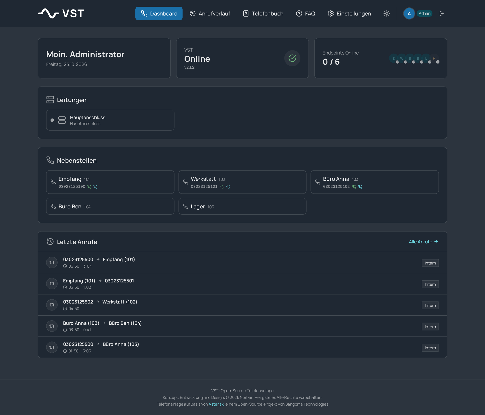

<p align="center">
  
</p>

<p align="center">
  <strong>A web interface for the Asterisk PBX.</strong><br>
  Extensions, SIP trunks, call routing, voicemail, IVR and live monitoring in one self-hosted Docker stack.
</p>

<p align="center">
  <a href="docs/INSTALLATION.md">Installation</a> ·
  <a href="docs/INSTALLATION.de.md">Installationsanleitung (Deutsch)</a> ·
  <a href="#features">Features</a> ·
  <a href="#screenshots">Screenshots</a> ·
  <a href="CHANGELOG.md">Changelog</a>
</p>

<p align="center"><a href="LICENSE"></a></p>

---

**VST** (German: *Vermittlungsstelle*, "telephone exchange") turns Asterisk into something you can run without editing config files. You manage extensions, trunks, inbound numbers, ring groups and menus in the browser. VST writes the PJSIP configuration and dialplan for you and reloads Asterisk.

It started as GonoPBX and has been renamed to VST. The code base is the same project; see the [changelog](CHANGELOG.md) for the history.

<p align="center">
  
</p>

## Features

- **Extensions**: SIP extensions with caller ID, codecs, call forwarding (always, busy, no answer), BLF hints and pickup groups
- **SIP trunks**: registration or IP authentication, ready-made profiles for Plusnet IPfonie, dus.net, Telekom DeutschlandLAN, CompanyFlex and All-IP residential lines, Iliad (Italy), and a generic custom trunk
- **Inbound routing (DIDs)**: assign inbound numbers to extensions; ring groups and IVR menus get their own inbound numbers; number blocks per trunk
- **Outbound caller ID**: choose the DID shown per extension; optional `P-Asserted-Identity` header
- **Ring groups**, **IVR menus** (multi-level, prompt upload with conversion) and **voicemail** with PIN, e-mail delivery (HTML) and an in-browser player
- **Phonebook**: global and per-extension, CSV import and export
- **Live dashboard** over WebSocket: Asterisk status, registered phones, active calls, recent calls
- **Call detail records** with filters and statistics
- **SIP debug**: live SIP message viewer grouped by call, with the raw message
- **Security**: IP allow-list for SIP registration, password-strength checks, audit log of every administrative action, Fail2Ban status, JWT login with admin and user roles
- **Home Assistant**: API key, click-to-call and MQTT events (`gonopbx/...` topics, see [Compatibility](#compatibility-notes))
- **German and English interface**, chosen at install time; dark mode
- **One-click update** from the web interface, or `./install.sh` again on the command line

## Screenshots

| Extensions | Trunk and inbound numbers |
|:---:|:---:|
|  |  |

| Call history | Security settings |
|:---:|:---:|
|  |  |

| Dark mode | Login |
|:---:|:---:|
|  |  |

## Quick start

You need a Linux machine with Docker Engine 24+ and the Compose plugin, a few GB of free disk space, and (for real calls) a SIP provider account.

```bash
git clone https://github.com/ankaios76/vst.git
cd vst
sudo ./install.sh
```

The installer asks a handful of questions (network mode, language, SIP port, admin password), generates all secrets, builds the images and starts the stack. Afterwards open `http://<server-ip>:3000` and log in as `admin`.

The full walkthrough, including router and firewall settings, a first trunk and extension, backups and troubleshooting, is in **[docs/INSTALLATION.md](docs/INSTALLATION.md)** (English) and **[docs/INSTALLATION.de.md](docs/INSTALLATION.de.md)** (German).

## How it fits together

```
 phones / softphones ──SIP/RTP──▶ ┌────────────┐      AMI      ┌────────────┐
 SIP provider ◀──────SIP/RTP───── │  Asterisk  │◀────────────▶│  Backend   │──▶ PostgreSQL
                                  │  (PJSIP)   │  config files │  (FastAPI) │
                                  └────────────┘◀──────────────└─────┬──────┘
                                                                      │ REST + WebSocket
                                                              ┌───────▼──────┐
                                              browser ───────▶│   Frontend   │
                                                              │ (React/nginx)│
                                                              └──────────────┘
```

| Component | Technology |
|-----------|------------|
| PBX engine | Asterisk 20 (PJSIP) |
| Backend | FastAPI (Python), SQLAlchemy, Panoramisk/AMI |
| Frontend | React, TypeScript, Vite, Tailwind CSS |
| Database | PostgreSQL 15 |
| Auth | JWT, bcrypt |
| Deployment | Docker Compose, four containers |

The backend is the source of truth. It renders `pjsip_peers.conf`, the dialplan, voicemail and queue configuration from the database into `asterisk/config/` and asks Asterisk to reload. Do not edit the generated files by hand; changes are overwritten.

## Security notes

Read these before exposing VST to the internet.

- The web interface speaks plain HTTP on port 3000. Put it behind a TLS reverse proxy (Caddy, nginx, Traefik) or reach it only over a VPN, and choose "reverse proxy" in the installer so that ports 3000 and 8000 bind to localhost.
- SIP on the open internet gets scanned constantly. Use strong extension passwords (the interface has a generator), the IP allow-list, and Fail2Ban on the host. Prefer a VPN for remote phones.
- The backend container mounts the Docker socket. That is what makes one-click updates work, and it is equivalent to root on the host for anyone who can run code in that container. If you do not want that, remove the `docker.sock` and `${PROJECT_DIR}` mounts from `docker-compose.yml` and update from the command line.
- There is no default password. The installer generates one (or asks for yours) and stores it in `.env`; keep that file private.

## Compatibility notes

Some internal names keep the GonoPBX spelling so that existing installations and integrations keep working after the rename:

- MQTT topics start with `gonopbx/` and the Home Assistant call events use `gonopbx_call:`
- internal e-mail placeholders end in `@gonopbx.local`
- the update container is called `gonopbx-updater`

## Updating

From the web interface: **Settings → Server → Update**. From the command line:

```bash
cd vst
git pull
sudo ./install.sh      # choose [1] Update: keeps data and passwords
```

Database migrations run automatically when the backend starts.

## Project layout

```
vst/
├── asterisk/            Dockerfile, sound prompts, music on hold, config templates
├── backend/             FastAPI application, config generators, AMI client
├── frontend/            React application (Vite, Tailwind)
├── docs/                Installation guides and screenshots
├── releases/            Release notes per version
├── docker-compose.yml
├── install.sh           Interactive installer and updater
└── CHANGELOG.md
```

## Contributing

Bug reports and ideas are welcome as [issues](https://github.com/ankaios76/vst/issues). Pull requests too; please describe what you changed and how you tested it.

## License

MIT, see [LICENSE](LICENSE). Asterisk itself, the bundled sound prompts and the music on hold files have their own licences.

## Credits

Written by Norbert Hengsteler in Bremen. VST builds on [Asterisk](https://www.asterisk.org), a project of Sangoma Technologies. The bundled English prompts are the Asterisk core sounds, and the music on hold files keep their original licences (see `asterisk/moh/`).
