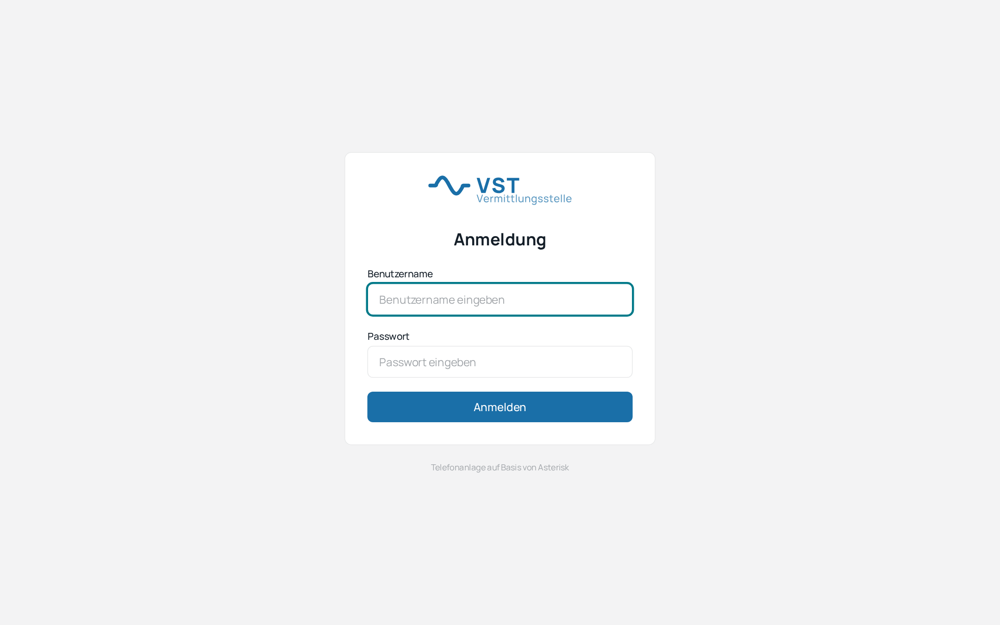
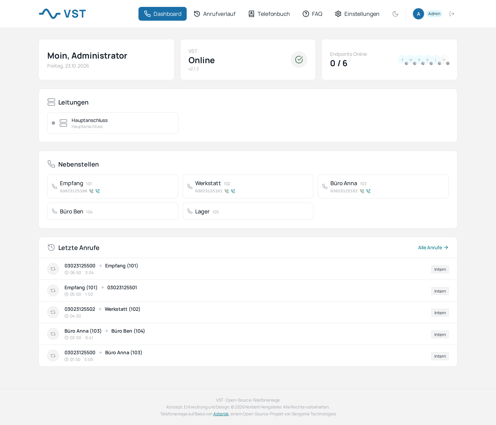
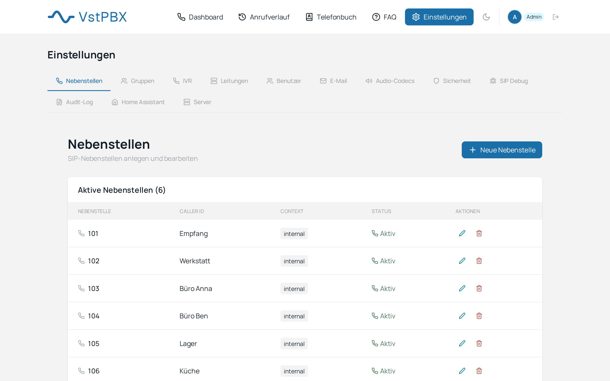
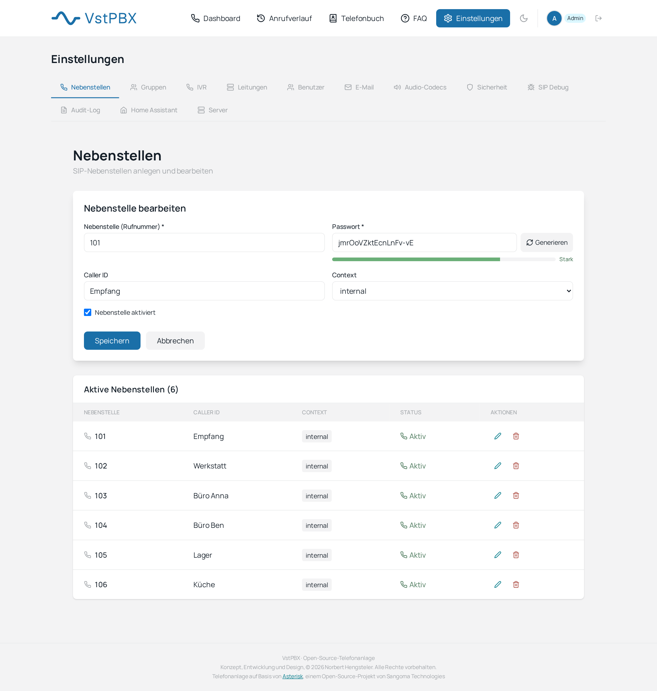
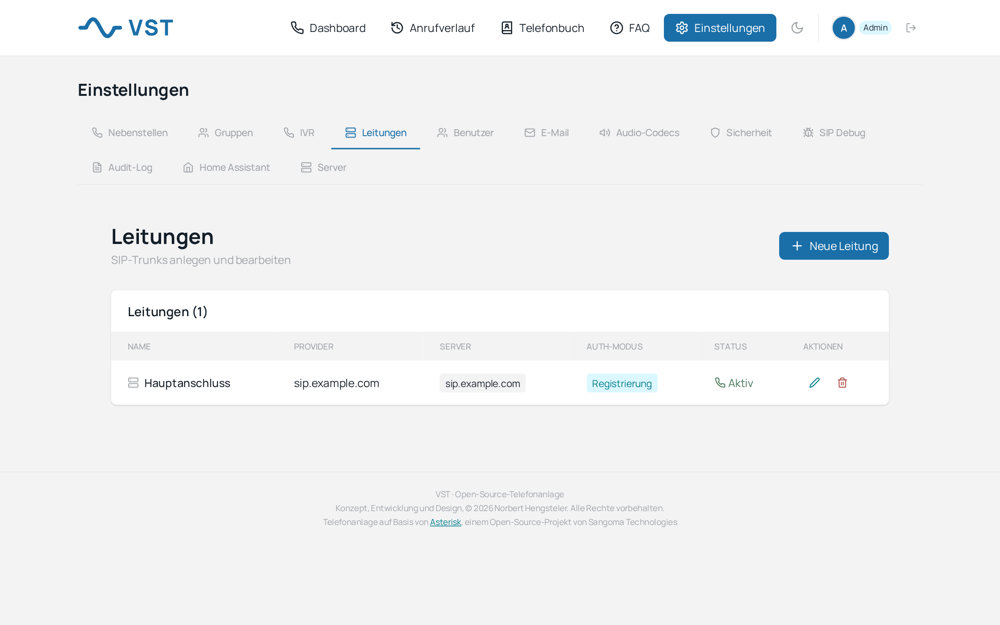
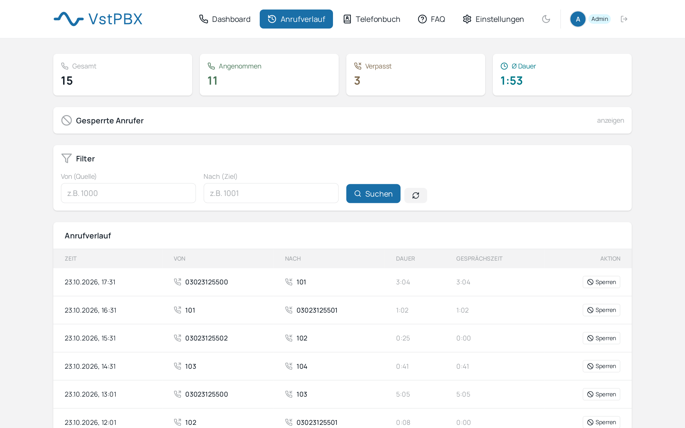
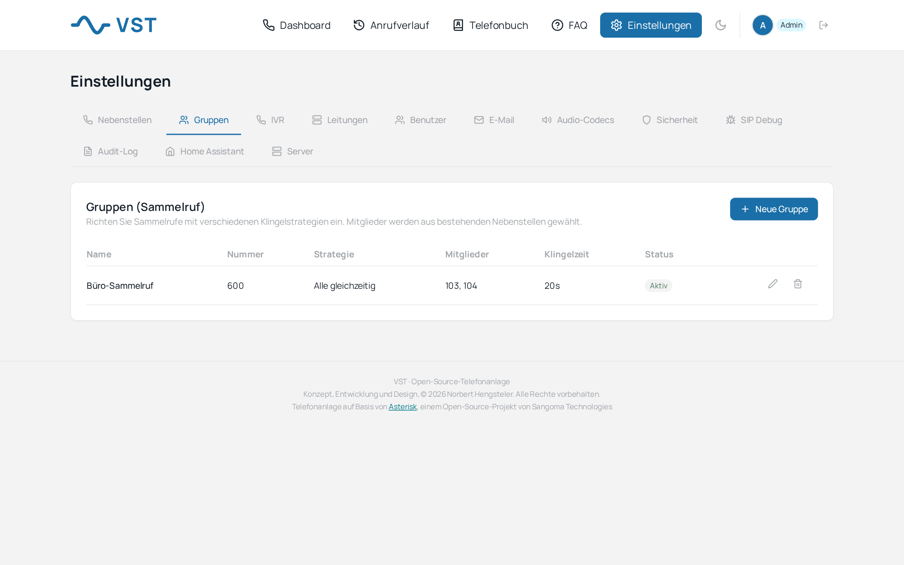
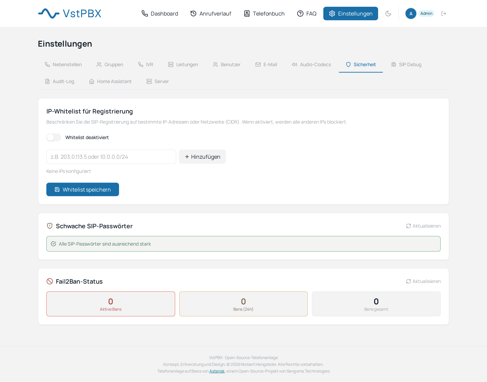

# VST installieren und einrichten

Diese Anleitung führt von einem leeren Linux-Rechner bis zum ersten Telefonat über VST. Sie ist für Leute geschrieben, die schon einmal ein Terminal benutzt haben, aber nicht für Asterisk-Profis. Die englische Fassung steht in [INSTALLATION.md](INSTALLATION.md).

**Inhalt**

1. [Was du brauchst](#1-was-du-brauchst)
2. [Das Netz vorbereiten](#2-das-netz-vorbereiten)
3. [Docker installieren](#3-docker-installieren)
4. [VST installieren](#4-vst-installieren)
5. [Erster Login](#5-erster-login)
6. [Erste Nebenstelle und erstes Telefon](#6-erste-nebenstelle-und-erstes-telefon)
7. [Leitung zum Provider und Rufnummern](#7-leitung-zum-provider-und-rufnummern)
8. [Optional: Voicemail, Sammelruf, IVR, Home Assistant](#8-optional-voicemail-sammelruf-ivr-home-assistant)
9. [Absichern: HTTPS, Firewall, Fail2Ban](#9-absichern-https-firewall-fail2ban)
10. [Betrieb: Logs, Backup, Update](#10-betrieb-logs-backup-update)
11. [Fehlersuche](#11-fehlersuche)
12. [Deinstallieren](#12-deinstallieren)

---

## 1. Was du brauchst

| | Mindestens | Empfohlen |
|---|---|---|
| Rechner | 2 CPU-Kerne, 2 GB RAM, 10 GB frei | 4 Kerne, 4 GB RAM |
| Betriebssystem | Debian 12 / Ubuntu 22.04 | Debian 13 / Ubuntu 24.04 |
| Software | Docker Engine 24+ mit Compose-Plugin, `git`, `curl`, `openssl` | |
| Netz | feste (oder reservierte) IP im LAN | |

Das geht auf einem Raspberry Pi 4/5 (64 Bit), einem Mini-PC, einer VM oder einem gemieteten Server. Das erste Bauen der Images dauert je nach Rechner 5 bis 15 Minuten.

Für echte Anrufe brauchst du außerdem einen **SIP-Zugang** deines Telefonanbieters (Benutzername, Passwort, Server) und mindestens ein **SIP-Telefon oder eine Softphone-App**. Zum reinen Ausprobieren reichen zwei Softphones: Interne Anrufe zwischen Nebenstellen funktionieren auch ohne Provider.

## 2. Das Netz vorbereiten

VST besteht aus vier Containern. Von außen musst du nur diese Ports erreichbar machen:

| Port | Protokoll | Wofür | Von wo erreichbar? |
|---|---|---|---|
| 3000 | TCP | Weboberfläche | nur LAN/VPN, oder über einen HTTPS-Proxy |
| 8000 | TCP | API (die Weboberfläche nutzt sie intern) | nur LAN/VPN |
| 5060 (oder dein Wunschport) | UDP und TCP | SIP | LAN; zum Provider nur ausgehend, siehe unten |
| 10000–10100 | UDP | RTP (die Sprache) | LAN; bei Telefonen im Internet auch von außen |

Drei Fälle kommen in der Praxis vor:

**a) Alles im Heimnetz oder Büro, Provider erreicht VST über Registrierung.** Das ist der einfachste Fall. VST meldet sich beim Provider an (ausgehende Verbindung), deine Telefone sind im selben LAN. Du musst am Router **nichts** freigeben. Gib dem VST-Rechner eine feste IP (DHCP-Reservierung im Router).

**b) Telefone außerhalb des Netzes (Homeoffice, Smartphone unterwegs).** Am besten über ein VPN (WireGuard), dann gilt wieder Fall a). Ohne VPN musst du 5060 und 10000–10100/UDP am Router auf den VST-Rechner weiterleiten und solltest unbedingt Kapitel 9 lesen.

**c) Provider ruft VST von außen an (IP-Authentifizierung ohne Registrierung).** Dann muss 5060 vom Provider aus erreichbar sein. Erlaube in der Firewall nur die Adressen deines Providers.

**SIP-ALG ausschalten.** Viele Router (FRITZ!Box, Speedport, ältere TP-Link) haben eine Funktion, die SIP-Pakete „repariert" und dabei kaputt macht. Typische Folgen: Telefon klingelt, aber man hört nichts, oder Anrufe brechen nach 30 Sekunden ab. Wenn du Probleme siehst und das ALG nicht abschalten kannst, wähle bei der Installation einen anderen SIP-Port als 5060 (zum Beispiel 5062). Das umgeht das ALG meistens.

**Externe IP.** Der Installer fragt nach der öffentlichen IP des Servers und schlägt die erkannte vor. Sie landet in der PJSIP-Konfiguration (`external_media_address`) und hilft Asterisk, in den SIP-Paketen die richtigen Adressen anzugeben. Hinter einem Router mit wechselnder IP ist das trotzdem in Ordnung für den Betrieb im LAN; für Verbindungen aus dem Internet solltest du eine feste Adresse oder einen DynDNS-Namen verwenden.

## 3. Docker installieren

Falls Docker schon läuft (`docker compose version` zeigt eine Version), überspringe diesen Schritt.

Auf Debian oder Ubuntu mit dem offiziellen Skript:

```bash
curl -fsSL https://get.docker.com | sudo sh
sudo usermod -aG docker $USER      # danach einmal ab- und wieder anmelden
```

Prüfen:

```bash
docker --version
docker compose version
git --version
```

Alle drei müssen eine Version ausgeben.

## 4. VST installieren

```bash
sudo git clone https://github.com/ankaios76/vst.git /opt/vst
cd /opt/vst
sudo ./install.sh
```

`/opt/vst` ist nur ein Vorschlag. Wichtig ist, dass der Ordner dauerhaft dort bleibt: Der Installer trägt ihn in die `.env` ein, und die Update-Funktion braucht ihn.

Der Installer stellt dir diese Fragen:

| Frage | Antwort |
|---|---|
| **Use this IP?** | Enter, wenn die erkannte Adresse stimmt. Sonst `n` und eigene eintragen. |
| **Nutzt du einen Reverse Proxy?** | `1` = Weboberfläche im ganzen Netz erreichbar (gut fürs Heimnetz). `2` = nur auf dem Server selbst erreichbar; dann brauchst du einen Proxy davor (Kapitel 9). Im Zweifel `2` und HTTPS davor setzen. |
| **Sprache** | `1` Deutsch, `2` Englisch. Die Sprache wird beim Bauen festgelegt. |
| **SIP-Port** | Enter für 5060, oder ein anderer Port (siehe SIP-ALG oben). |
| **Admin-Passwort** | Leer lassen, dann erzeugt der Installer ein zufälliges. Es steht danach in der Datei `.env`. |
| **Home Assistant** | `N`, wenn du es nicht brauchst. Lässt sich später in den Einstellungen nachholen. |

Danach baut der Installer die Images und startet alle Container. Am Ende zeigt er die Adressen an. Prüfen kannst du es so:

```bash
docker compose ps
```

Alle vier Container (`pbx_asterisk`, `pbx_backend`, `pbx_frontend`, `pbx_postgres`) sollten `Up` zeigen, Asterisk und PostgreSQL zusätzlich `healthy`.

Das Admin-Passwort liest du bei Bedarf so aus:

```bash
sudo grep ADMIN_PASSWORD /opt/vst/.env
```

Die Datei `.env` enthält alle Geheimnisse der Installation. Gib sie nicht weiter und lege sie nicht in ein öffentliches Repository.

## 5. Erster Login

Öffne im Browser `http://<IP-des-Servers>:3000` (bei Variante 2 vom Server selbst aus oder über deinen Proxy). Melde dich als `admin` mit dem Passwort aus der `.env` an.



Das Dashboard zeigt oben den Zustand von VST und Asterisk und die Zahl der angemeldeten Telefone, darunter Leitungen, Nebenstellen und die letzten Anrufe.



Ändere als Erstes dein Passwort: oben rechts auf dein Namenskürzel (den runden Avatar) klicken, das Fenster „Passwort ändern" öffnet sich. Das neue Passwort gilt ab sofort; der Wert in der `.env` wird beim nächsten Neustart des Backends **wieder** über das Passwort gelegt, das dort steht. Wenn du das nicht willst, trage das neue Passwort auch in der `.env` ein (`ADMIN_PASSWORD=...`) und starte das Backend neu: `docker restart pbx_backend`.

## 6. Erste Nebenstelle und erstes Telefon

**Einstellungen → Nebenstellen → Neue Nebenstelle.**



Trage ein:

- **Nebenstelle:** die interne Rufnummer, zum Beispiel `101`
- **Caller ID:** der Name, der bei internen Anrufen angezeigt wird (zum Beispiel „Empfang")
- **Passwort:** am besten mit dem Knopf **Generieren** erzeugen. Der Balken darunter zeigt die Stärke des Passworts.

Speichern. VST schreibt die Konfiguration und lädt Asterisk neu.

**Das Telefon einrichten.** In jedem SIP-Telefon oder Softphone (Yealink, Snom, Grandstream, Linphone, Zoiper, Fritz!Fon über die FRITZ!Box, …) trägst du ein:

| Feld im Telefon | Wert |
|---|---|
| SIP-Server / Registrar | IP des VST-Rechners |
| Port | 5060 (oder dein gewählter Port) |
| Benutzername / Auth-ID | die Nebenstelle, zum Beispiel `101` |
| Passwort | das Passwort der Nebenstelle |
| Transport | UDP |
| Codec | G.722, A-law (PCMA), µ-law (PCMU) |

Nach dem Speichern erscheint die Nebenstelle auf dem Dashboard als angemeldet. Lege eine zweite Nebenstelle an, melde ein zweites Telefon an und rufe `102` von `101` aus an: Damit hast du bewiesen, dass VST und Asterisk laufen, ohne dass ein Provider im Spiel ist.

In der Detailansicht einer Nebenstelle (Stift-Symbol in der Liste) gibt es fünf Reiter: **Rufnummern** (eingehende Nummern und ausgehende Rufnummer), **Rufumleitung** (immer, bei besetzt, bei keiner Antwort), **Voicemail**, **Audio-Codecs** und **Funktionen** (zum Beispiel BLF und Pickup-Gruppe).



## 7. Leitung zum Provider und Rufnummern

**Einstellungen → Leitungen → Neue Leitung.**



1. **Anbieter wählen.** Für Plusnet IPfonie, dus.net, Telekom DeutschlandLAN, CompanyFlex, Telekom All-IP (Privatkunden, MagentaZuhause) und Iliad Italien sind Server und Besonderheiten schon hinterlegt. Für alles andere nimmst du den freien Eintrag und gibst den SIP-Server selbst ein.
2. **Zugangsdaten** vom Provider eintragen (Benutzername, Passwort; bei Telekom All-IP zusätzlich die Anschlussnummer als „From-User").
3. **Anmeldeart:** Registrierung (VST meldet sich beim Provider an) oder IP-Authentifizierung (der Provider schickt von festen Adressen). Welche gilt, steht in den Unterlagen deines Providers.
4. **Rufnummernblock:** Wenn du mehrere Nummern hast, trägst du den Block ein, zum Beispiel `03023125100-03023125199`. Das macht später die Auswahl bequemer.

Speichern. Auf dem Dashboard erscheint die Leitung mit einem Statuspunkt. Grün heißt: beim Provider angemeldet.

**Eingehende Rufnummer einer Nebenstelle zuweisen.** In der Nebenstelle im Reiter **Rufnummern** die Rufnummer und die Leitung wählen. Sammelrufgruppen und IVR-Menüs bekommen ihre eigene eingehende Nummer in ihrer Maske.

**Ausgehende Rufnummer.** Wähle im Reiter **Rufnummern**, welche der zugewiesenen Nummern bei Anrufen nach außen angezeigt wird. Optional setzt VST den Kopf `P-Asserted-Identity` mit der Hauptnummer des Blocks; manche Provider verlangen das bei Rufnummernblöcken. Bei Telekom All-IP setzt VST automatisch die Anschlussnummer als Absender.

**Testen.** Rufe von einem Mobiltelefon deine Nummer an: Die zugewiesene Nebenstelle muss klingeln. Dann ruf von der Nebenstelle eine Mobilnummer an, die vor der Nummer eine `0` bekommt (`0151…`). Beides erscheint kurz danach im **Anrufverlauf**.



## 8. Optional: Voicemail, Sammelruf, IVR, Home Assistant

**Voicemail.** Jede Nebenstelle bekommt automatisch eine Mailbox. Die Ringzeit bis zur Mailbox und die PIN stellst du in der Nebenstelle ein. Die eigene Mailbox rufst du vom Telefon mit `*98` ab; `*97` plus Nebenstelle (zum Beispiel `*97101`) öffnet die Mailbox einer bestimmten Nebenstelle. Die Ansagen laufen auf Deutsch, weil das deutsche Asterisk-Soundpaket im Image enthalten ist. Ein Anruf, der unbeantwortet bleibt, landet nach der eingestellten Ringzeit in der Mailbox. Damit Nachrichten auch per E-Mail kommen, trägst du unter **Einstellungen → E-Mail** deinen SMTP-Server ein (Port 465 oder 587 erkennt VST selbst) und schickst eine Test-E-Mail.

**Sammelruf (Gruppen).** **Einstellungen → Gruppen**: Name, interne Nummer, Mitglieder, Strategie (alle gleichzeitig, Rundruf, am längsten frei) und Klingeldauer. Optional eine eingehende Nummer zuordnen.



**IVR (Sprachmenü).** **Einstellungen → IVR**: Ansage hochladen (VST wandelt sie in das richtige Format um), Tasten zu Zielen zuordnen, Wiederholungen festlegen, optional eine eingehende Nummer zuordnen.

**Telefonbuch.** Globale und persönliche Kontakte, Import und Export als CSV. Gespeicherte Namen erscheinen im Anrufverlauf.

**Home Assistant.** **Einstellungen → Home Assistant**: API-Schlüssel erzeugen, MQTT-Broker eintragen, Verbindung testen. VST veröffentlicht Anrufereignisse und Status per MQTT (Topics `gonopbx/...`, der Name ist aus Kompatibilitätsgründen geblieben) und bietet einen Endpunkt zum Anrufen per Klick.

## 9. Absichern: HTTPS, Firewall, Fail2Ban

Lies dieses Kapitel, bevor irgendetwas aus dem Internet erreichbar ist.

**HTTPS vor die Weboberfläche setzen.** Wähle bei der Installation „Reverse Proxy" (Variante 2); dann lauschen Port 3000 und 8000 nur auf `127.0.0.1`. Mit Caddy genügt dann zum Beispiel:

```
vst.example.org {
    reverse_proxy 127.0.0.1:3000
}
```

Caddy holt das Zertifikat selbst. Der nginx im Frontend-Container leitet `/api` und `/ws` (WebSocket) selbst an das Backend weiter, du musst also nur Port 3000 durchreichen. Willst du die Weboberfläche gar nicht ins Internet stellen, erreiche sie über ein VPN.

**Firewall auf dem VST-Rechner.** Beispiel mit `ufw`, wenn VST in einem Heimnetz `192.168.1.0/24` steht:

```bash
sudo ufw default deny incoming
sudo ufw allow from 192.168.1.0/24 to any port 22 proto tcp
sudo ufw allow from 192.168.1.0/24 to any port 3000 proto tcp
sudo ufw allow from 192.168.1.0/24 to any port 5060
sudo ufw allow from 192.168.1.0/24 to any port 10000:10100 proto udp
sudo ufw enable
```

Achtung: Docker setzt seine Portfreigaben **an `ufw` vorbei**. Veröffentlichte Container-Ports sind trotz `ufw` erreichbar. Bindest du die Ports bei der Installation auf `127.0.0.1` (Variante 2) und verwendest für SIP gezielt Regeln in der `DOCKER-USER`-Kette oder eine Firewall am Router, bist du auf der sicheren Seite.

**SIP-Whitelist.** Unter **Einstellungen → Sicherheit** kannst du festlegen, von welchen Adressen sich Telefone anmelden dürfen. Für ein Büro-LAN ist das die wirksamste Einzelmaßnahme.

**Fail2Ban.** Läuft Fail2Ban auf dem Host, zeigt VST unter **Sicherheit** aktive Sperren und Jails an. Ein Jail für Asterisk (`asterisk`) sperrt Adressen nach fehlgeschlagenen Anmeldungen. Das Asterisk-Log liegt im Projektordner unter `asterisk/logs/`.

**Starke Passwörter.** Der Reiter **Sicherheit** (Whitelist, Passwortprüfung und Fail2Ban-Status) listet Nebenstellen mit schwachem Passwort. Gib jeder Nebenstelle ein erzeugtes Passwort.

**Docker-Socket.** Der Backend-Container bindet `/var/run/docker.sock` ein. VST braucht das, um Asterisk nach jeder Änderung neu zu laden (es führt `asterisk -rx reload` im Asterisk-Container aus) und für das Update aus der Weboberfläche. Das ist faktisch Root-Zugriff auf den Host für jeden, der Code im Backend ausführen kann. Stelle deshalb Port 8000 nie ins Internet und halte die Weboberfläche hinter VPN oder HTTPS-Proxy. Entfernst du den Zugang, startet die Oberfläche trotzdem, aber Asterisk übernimmt Änderungen nicht mehr von selbst: Du müsstest nach jeder Änderung den Container `pbx_asterisk` neu starten.



## 10. Betrieb: Logs, Backup, Update

**Status und Logs**

```bash
cd /opt/vst
docker compose ps                 # läuft alles?
docker compose logs -f backend    # Backend live
docker compose logs -f asterisk   # Asterisk live
docker exec -it pbx_asterisk asterisk -rvvv    # Asterisk-Konsole
```

In der Asterisk-Konsole zeigt `pjsip show endpoints`, welche Telefone angemeldet sind, und `pjsip show registrations`, ob die Leitung beim Provider registriert ist.

**Neustart:** `docker compose restart`. Alle Container starten nach einem Reboot des Servers von selbst (`restart: unless-stopped`).

**Backup.** Gesichert werden muss:

1. die Datenbank (Nebenstellen, Leitungen, Routen, Anrufverlauf, Benutzer),
2. die Voicemail-Nachrichten und Uploads (Docker-Volumes),
3. die Datei `.env`.

Ein einfaches Skript, das du per Cron täglich laufen lässt:

```bash
#!/bin/bash
set -e
cd /opt/vst
DEST=/var/backups/vst/$(date +%F)
mkdir -p "$DEST"
docker exec pbx_postgres pg_dump -U asterisk asterisk_gui | gzip > "$DEST/db.sql.gz"
for v in asterisk_voicemail user_uploads; do
  docker run --rm -v "$(basename "$PWD")_$v":/data -v "$DEST":/out alpine \
    tar czf "/out/$v.tgz" -C /data .
done
cp .env "$DEST/env" && chmod 600 "$DEST/env"
```

Kopiere den Backup-Ordner an einen **anderen** Ort (anderer Rechner, NAS, Cloud-Speicher). Ein Backup auf derselben Platte schützt nicht vor einem Plattenausfall.

Die Volumes heißen `<Ordnername>_asterisk_voicemail` und `<Ordnername>_user_uploads`; bei `/opt/vst` also `vst_…`. Mit `docker volume ls` siehst du die genauen Namen.

**Wiederherstellen** auf einem frisch installierten VST:

```bash
cd /opt/vst
docker compose stop backend
gunzip -c /pfad/zum/backup/db.sql.gz | docker exec -i pbx_postgres psql -U asterisk -d asterisk_gui
docker compose start backend
```

Das Backend schreibt beim Start die Asterisk-Konfiguration aus der Datenbank neu.

**Update**

Weboberfläche: **Einstellungen → Server → Update**. Kommandozeile:

```bash
cd /opt/vst
sudo git pull
sudo ./install.sh        # bei der Frage "[1] Update" wählen
```

Der Update-Modus behält Daten und Passwörter und baut die Container neu. Datenbank-Änderungen laufen beim Start automatisch. Mach vor einem Update ein Backup.

## 11. Fehlersuche

**Die Weboberfläche lädt nicht.** `docker compose ps` prüfen. Läuft `pbx_frontend`? Bei Installationsvariante 2 ist Port 3000 nur auf `127.0.0.1` offen. Dann musst du über den Proxy oder per SSH-Tunnel (`ssh -L 3000:127.0.0.1:3000 user@server`) zugreifen.

**Anmeldung scheitert.** Das Passwort steht in der `.env`. Zurücksetzen: dort `ADMIN_PASSWORD` ändern, dann `docker restart pbx_backend`.

**Telefon meldet sich nicht an.** Prüfe Nebenstelle, Passwort und Server-Adresse. In **Einstellungen → SIP Debug** kannst du die SIP-Nachrichten live mitlesen: Kommt ein `REGISTER` an? Antwortet VST mit `401` (Passwort falsch) oder gar nicht (Netz/Firewall)? Hilfreich ist auch `docker compose logs asterisk`.

**Telefon klingelt, aber man hört nichts oder nur eine Seite.** Fast immer NAT oder SIP-ALG. Prüfe, ob UDP 10000–10100 erreichbar ist, die externe IP in der `.env` stimmt und das SIP-ALG des Routers aus ist (Kapitel 2).

**Anruf bricht nach etwa 30 Sekunden ab.** Das ACK erreicht den Server nicht: ebenfalls typisch für ALG oder eine falsche Weiterleitung. Anderen SIP-Port wählen.

**Leitung wird nicht grün.** Zugangsdaten, Server und Anmeldeart prüfen. `pjsip show registrations` in der Asterisk-Konsole nennt den Grund (`Rejected`, `Unregistered`, …). Beim Provider ist manchmal ein Freischalten des SIP-Zugangs nötig.

**Ausgehende Anrufe werden vom Provider abgewiesen.** Meist die falsche Absendernummer. Wähle in der Nebenstelle eine ausgehende Nummer, die dir gehört (Format wie beim Provider, oft ohne führende `+`), und prüfe, ob der Provider `P-Asserted-Identity` verlangt.

**E-Mail der Voicemail kommt nicht an.** Unter **Einstellungen → E-Mail** die Test-E-Mail senden. Die Fehlermeldung nennt den Grund (Login, Port, TLS).

**Es hilft nichts.** `docker compose logs --tail 200 backend asterisk` ansehen und ein [Issue](https://github.com/ankaios76/vst/issues) öffnen. Schwärze dabei Passwörter und öffentliche IP-Adressen.

## 12. Deinstallieren

```bash
cd /opt/vst
docker compose down -v      # entfernt Container UND Daten (Datenbank, Voicemail)
cd / && sudo rm -rf /opt/vst
```

Ohne `-v` bleiben die Docker-Volumes mit deinen Daten erhalten.
